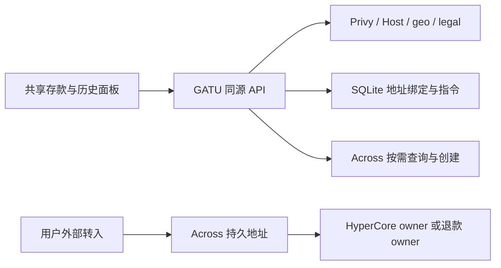

# Across 持久充值地址接入设计

状态：拟议，尚未实现、联调或发布。修订日期：2026-09-13；本次复核基线：`965e0590`。原 `0662cae1` 方案的[首轮复核](work-memory/sessions/2026-09-13-across-plan-review-followup.md)与本轮 [N1–N8 处置](work-memory/sessions/2026-09-13-across-rereview-resolution.md)保留依据。当前运行行为继续由 [CCTP](cctp-deposits.md)、[首次交易](trading-onboarding.md)及[资金入口](account-overview.md)约束；官方资料按[共享阅读流程](across-reference.md)核对。

## 1. 目标与首期范围

为邮箱用户提供从交易所或其他钱包转入的持久地址，由 Across 归集并交付至指定 HyperCore owner，减少返回 GATU 再确认存款的操作及 Smart Wallet/Paymaster 初始化依赖。固定 SPOT 落点可能仍需显式账户模式选择或 Spot→Perp 划转；减少的操作数须实测，不能承诺所有用户一步即可交易。

首期采用现有同源服务端 REST、SQLite 两张地址表和按需转账查询。不引入 App SDK、Swap/Gasless API、新钱包 Provider、独立 worker、定时巡检或转账全量镜像。Across 执行归集、交付和协议支持的退款；GATU 查询用于展示和排障，不是这些资金操作的执行器。代价是首期不提供离线通知、主动发现所有历史异常或独立于供应商的完整交易档案；有这些产品需求时另加后台任务和事件存储。取舍见 [ADR 0004](adr/0004-across-deposit-addresses.md)。

首期仅 mainnet 邮箱用户的准确 embedded EVM owner、原生 USDC 和 USDC-SPOT 目标。先验收 Arbitrum，再逐条开放 Ethereum/Base/Polygon；不承诺四链同时上线。输入集合为“产品已验收白名单 ∩ 当前地址 supportedInputs”，不能用 Swap 链目录自动扩链。外部钱包新 PDA、Agent-only、观察地址、子账户、vault、多签、测试网、USDT、Tron、提现和自动划转不在范围内。

保留外部 CCTP、邮箱旧余额的显式 CCTP 与全部在途恢复。`config/cctp-deposit.ts` 的 sponsored gate 缺省关闭，但生产既支持 `external-only` 也支持 `both`；部署文档含 `both` 示例，本次没有读取真实环境配置，不能断言当前生产邮箱路径一定关闭。只有 sponsored 当前可用时才展示“存入钱包现有 USDC”；否则提供钱包余额恢复入口，不展示无法执行的充值选项。若部署选择 `external-only`，Across 启用后才成为该部署的邮箱主充值入口；关闭 Across 不得悄悄开启 sponsored。

## 2. 官方契约与证据边界

| 核对项 | 已知事实及约束 |
| --- | --- |
| 地址与权限 | [PDA 指南](https://docs.across.to/introduction/persistent-deposit-addresses)及[创建接口](https://docs.across.to/api-reference/deposit-addresses/post)：相同参数复用地址、金额不参与创建，需 `deposit-address` 权限，接口位于 Early Access。生产权限未取得 |
| 请求与响应 | 指南、cURL 及本轮取得的页面 Request Body 类型均将 `destination.recipient` 定义为字符串；200 响应为 `{namespace,address}`，与报告的“请求 schema 为对象”不符。以字符串实现请求，P0 用项目权限验证运行契约，不通过失败后换参数形态试建地址 |
| 退款与标识 | 正文称 `refundAddresses` 可选，已取得的 Request Body 类型要求该数组；GATU 要求非空且归属正确。200 类型明确将 `id` 描述为报障使用的 request ID，原方案的诊断用途成立；不能拿它做地址或转账主键。`expiresAt` 定义为 null，但路线和费用不因此永久有效 |
| 主机与 Integrator ID | [鉴权页](https://docs.across.to/introduction/api-keys)使用 `app.across.to/api`，PDA 示例使用 `across.to/api`。拟默认后者，P0 验证鉴权、重定向和 Integrator ID 在 PDA 中的具体用法；普通公开 GET 两主机相通不能证明带 Key 请求等价 |
| 金额与费用 | 创建示例的输入 USDC 为 6 位、USDC-SPOT 为 8 位；`indicativeFees.proportionalPct` 为字符串、`fixedFeeUsd` 为 USD 数值，时间字段 `indicativeFillTime` / `indicativeFillTimeRange` 单位为秒，均可为 null；费用也可为 null，响应许多属性非必填。倍率、费用包含项和激活扣费口径仍需确认，不能套用旧 suggested-fees 的倍率；关键目的/退款/指令缺失时拒绝曝光 |
| 限额与重新报价 | [FAQ 的地址章节](https://docs.across.to/introduction/faq#deposit-addresses)：按归集时实际余额重新报价，输入需落在对应链/币的 limits 内；重取地址刷新支持输入。显示的是指示性费用，用户数日后复用保存的地址时不受页面缓存时效保护 |
| 查询与分页 | [列表](https://docs.across.to/api-reference/deposits/get)：`limit` 默认 50、最大 1000，`skip` 为偏移，按 `depositBlockTimestamp` 降序，无供应商 cursor。`depositAddress` 模式忽略除分页外其他过滤，不能与 `sweepTxnRef` 合用；通常有 1–15 秒索引延迟 |
| 单笔与批量 | [详情](https://docs.across.to/api-reference/deposit/get)只选一种 selector；一笔 sweep 可含多次 PDA 执行，应查列表。inbound 的 `depositTxnRef`、`sweepTxnRef`、桥交付和 `actionsTarget*` 不可混用 |
| HyperCore | Across 命名空间使用 `1337`，HyperEVM 为 `999`。PDA 示例为 USDC-SPOT `0x2000000000000000000000000000000000000000`；[HyperCore 指南](https://docs.across.to/introduction/hypercore)主要描述 Swap 流程，不能据其示例自动认定 PDA 的所有模式已验收或 PERPS 可用 |
| 首次激活 | [Hyperliquid 激活费](https://hyperliquid.gitbook.io/hyperliquid-docs/for-developers/api/activation-gas-fee)：首次以新 HyperCore 账户为目的地的交易收取 1 个报价币。已激活但余额为零不等于新账户；供应商是否代付、预先激活、字段是否净额须另核对 |
| 官方前端不是通用承诺 | [HL 邮箱充值 FAQ](https://hyperliquid.gitbook.io/hyperliquid-docs/support/faq/deposit-or-transfer-issues-missing-lost/deposited-usdc)描述自己的四链、误币自动转回及小额规则；Across 通用 FAQ 对误链误币要求人工恢复。GATU 不继承“10 分钟自动退回”“低于 5 退回/低于 1 丢失”等集成特定结论 |

本方案以 public PDA API 为边界，不混入[新版统一 API](https://exclusive.docs.across.to/introduction/v5-api)的 staging、executions/transfers 或 `isTerminal` 语义。只使用 GATU 自有权限，不复制 HL 官方前端凭证或依赖其未公开的 `/hyperliquid-transfers` 服务。公开文档核对不证明生产路线、配额、账户模式和真实资金已经验证。

## 3. 用户流程与充值资格

1. 保留 exact owner → legal → signer → 完整资金快照的 onboarding 顺序。自动打开充值仍需完整、新鲜、明确为空的快照；手动打开无需账户为空。邮箱可先进入面板准备钱包，但展示地址前必须激活准确 owner；浏览器阻断 Privy 时不绕过此门控。
2. 通过方法能力集合展示可用方式：`external-cctp | embedded-cctp | across-address`。保留 CCTP 的 sponsored gate、`usdcRouting === cctp` 和执行保护，Across 用独立服务端 capability。`reason` 同步扩展 Across 关闭、灰度资格和维护类别，不能只改 path。
3. Across 后端验证身份、Host 环境、用户真实 IP、legal 和收款场景，持久绑定提交成功后才返回可曝光地址。不构造 Smart Wallet、不请求 EIP-3009、不审批 Agent/builder、不自动签名。
4. 面板标明原生 USDC/源链、Across 地址、当前限额、指示性费用、可能的首次激活费、SPOT 收款语义及退款 owner。ETA 缺失时不展示；费用单位未确认或信息不足时不开放该路线。金额未知时不显示一个虚构的固定“到账金额”。
5. 展示前复核路线与 owner，切账户/环境、退出或门控失效立即清理 QR 与旧请求；“完成”仅关闭弹窗。用户关闭页面后 Across 仍处理资金，重新打开时查询该地址的当前记录。首次发址必须主动确认账户/环境仍匹配，不依赖短暂显示后再清理。
6. 按 §7 区分供应商报告、最终交付证据和账户可交易。模式选择及内部划转沿用明确的用户操作；不能为显得“一步到账”自动切模式。

充值接收能力不能直接复用 `getAccountModeAvailability()` 的交易可用性：

| 已验证账户情况 | 地址曝光与后续行为 |
| --- | --- |
| 成功的 `userRole` 返回 `missing`，且属于准确邮箱 owner | 作为独立“首次激活”收款场景；P0/P3 证明可达后允许手动充值。模式尚未建立或返回 `default` 不等于 API 失败，不要求先完成无法执行的模式交易 |
| 普通 `user`，返回 `disabled` / `unifiedAccount` / `portfolioMargin` | 按已验收 SPOT 收款场景开放；交易仍依赖该模式的新鲜余额与现有 guards |
| 普通 `user`，成功返回已知 `default` | 不能当成 Standard；将其纳入独立收款验收，可展示地址后由现有弹窗显式选择支持模式，未选择前保持交易禁用 |
| 旧 `dexAbstraction`、未来未知模式、角色/多签检查失败或未知 | 首期不开放；后续单独验证。超时、null、缺失快照不能冒充 `missing` 或 `default` |

服务器角色检查接受 `missing/user`，排除 `agent/subAccount/vault`；普通 user 仍需验证不是多签配置，不能靠 Privy 地址类型推断。首次场景、既有 default 和各支持模式分别有发布资格，不把“已验收模式”写成“必须先有账户”。

## 4. 模块边界与接口

| 模块 | 文件落点与责任 |
| --- | --- |
| 服务端路由 | 沿 `apps/terminal/src/routes/api.leaderboard.ts` 增加 `api.deposits.across.*.ts`，不手改 `routeTree.gen.ts` |
| 身份与外部适配 | 新增 `lib/auth/privy-server.ts`、`lib/across/server/{client,schemas,service,repository}.ts`，schema/超时/归属与错误归一化；数据库和秘密不进入共享 barrel 或客户端 import graph |
| 领域与能力 | 新增 `domain/trade/across-deposit.ts`；扩展 `domain/trade/deposit-availability.ts`、`hooks/trade/use-deposit-availability.ts`；查询 hooks 不做金融计算 |
| 共享 UI | `deposit-modal.tsx` 分发，复用 `tradebox/deposit/funding-address-card.tsx` 的 QR/复制及现有 `qrcode@1.5.3`；被动错误不能直接套用该卡片的警告态，遵循移动展示契约 |
| 恢复入口 | 在共享用户菜单/退款面板增加显式导出操作；`use-deposit.ts`、`embedded-deposit-auto-bridge.tsx` 和 CCTP tracking 保留现有执行/恢复边界 |
| 部署 | 修改 `vite.config.ts`、`deploy/gatu.service`、部署预检、环境示例和恢复说明；首期没有新 worker unit |

拟新增 API 均同源、Bearer 认证，响应及错误统一 `Cache-Control: private, no-store`、`Referrer-Policy: no-referrer`；在 Nitro routeRules 同步覆盖 `/api/deposits/across` 及其子路径，不进入 CDN、Service Worker、共享 SSR 或浏览器持久 Query 缓存。

| GATU 接口 | 输入与责任 |
| --- | --- |
| `GET /api/deposits/across/capability` | 当前认证用户的发布/pilot资格、可选方法和维护状态；不是一次性越过后续门控的授权 |
| `POST /api/deposits/across/address` | 仅 `expectedOwner`、recipeVersion、sourceChain，版本必须在服务端启用配置内；源链仅用于验证/选择 instruction，不任意指定 recipient、refund、目标币或上游 URL |
| `GET /api/deposits/across/addresses` | 读取同 app/environment/DID/owner 的全部历史绑定版本；退役记录不提供新充值 QR/复制按钮 |
| `GET /api/deposits/across/transfers?addressId&limit&skip` | 后端按本地绑定取真实地址查询 Across；首期固定每页 50、有界非负 skip，不向前端开放任意地址过滤 |
| `GET /api/deposits/across/transfer?addressId&recordRef` | recordRef 为不可预测的临时引用，在有界内存中映射 DID/环境/地址及已核验列表行的 selector；不接受任意 hash 代理查询。引用过期或进程重启后重查列表，详情再次验证归属；引用不是授权凭证 |

所有路由限制方法、请求体大小及参数长度，先验身份再访问数据库/上游，Privy token 不转发给 Across。分页和详情均有独立配额。响应仅保留本产品需要的状态与引用；未归属或不匹配数据不返回。Across 记录不写入 CCTP nonce/hash store，不能触发旧桥重试。创建/曝光重新检查全部能力；历史读取保留身份与环境隔离，但不因新的 geo/legal/发布关闭而封死已有资金排查。

客户端每次请求前调用公开 `usePrivy().getAccessToken(): Promise<string | null>`，SDK 会在过期或将过期时尝试刷新；不调用内部接口或虚构 forceRefresh 参数。返回 null/失败时不发送请求；只对明确的认证失效至多重新取 token 并重试一次，同参数地址请求仍须幂等。重试前后核对 session/owner/environment，变化即取消。403、429、超时不触发刷新循环或自动登录/签名；被动获取失败遵循展示契约，主动操作保留反馈。此模块不另存 token 到缓存、日志或浏览器持久存储。[Privy access tokens](https://docs.privy.io/authentication/user-authentication/access-tokens)。

## 5. 身份、环境与访问门控

环境由受信任请求的 canonical Host 决定，复用 `config/public-origins.ts` 的 `getCanonicalNetworkForHostname()`：`app.gatu.ai` 对应 mainnet，`testnet.gatu.ai` 不开放 PDA 创建；测试域历史不得读取主网绑定。校验 request URL、Host 和同源 Origin 的一致性，拒绝未知域，不接受客户端 network 或任意转发头切换环境。沿既有 Caddy 反代与 loopback 监听边界验证真实用户 IP；Host 是环境选择，不是用户授权。开发回环仅走显式 mock 环境/独立 DB，不因 loopback 获得生产权限。

后端拟锁定 `@privy-io/node` 的已验证版本；本轮核对 0.34.0 类型，方法为 `privy.utils().auth().verifyAccessToken(accessToken)` 与 `privy.users()._get(did)`。[Node 初始化](https://docs.privy.io/basics/nodeJS/setup)、[用户查询](https://docs.privy.io/user-management/users/managing-users/querying-users)、[Access token](https://docs.privy.io/authentication/user-authentication/access-tokens)供实施复核。验证 issuer、App ID audience、expiry、DID/sid；公开 verification key/JWKS 可用于本地验签，但要保留轮换机制，它不代替用户关联查询和删除/解绑检查。

服务端 `linked_accounts` 的 snake_case 字段先适配为内部模型。必须证明邮箱关联及 EVM embedded 钱包归属，排除 `smart_wallet`；字段缺失或未知变体失败关闭。再按 `lib/wallet/privy-wagmi.ts` 的准确 primary、唯一候选、唯一 HD index-0 的顺序解析。该函数不是强制 index-0，不能按报告建议只保留 `wallet_index===0`；服务端无可验证 primary 时不得采信浏览器自称 primary，多候选仍无法唯一解析则拒绝并要求明确的同端解析修订。`expectedOwner` 只是比对条件，不能作为归属证明。

`destination.recipient` 和非空 refund 均由服务器固定为这个 owner；源链交易所发送方不能成为退款人。归属必须绑定原 DID/钱包/环境，邮箱字符串不作为稳定身份。[Privy 删除用户](https://docs.privy.io/user-management/users/managing-users/deleting-users)会导致重新登录生成新 DID/钱包；旧记录不得自动转给同邮箱新账号。旧 owner 解绑/不可登录时保留原映射，拒绝普通接口越权读取，提供 Privy/Across 人工恢复流程并注明恢复不保证。首期不新增用户删除或钱包改绑功能；有已发地址时，未来增加删除功能必须先设计导出与退役流程。

legal 与 geo 分开验证：现有客户端 fresh legal gate 保留；后端 IPdata 判定真实用户 IP。SDK `legalCheck` 有 `acceptedTerms/userAllowed/restrictions`，`u` 表示 UK 限制，但文档没有证明这些字段只取决于请求出口，也没有证明只取决于 owner。[SDK schema](https://nktkas.gitbook.io/hyperliquid/api-reference/info-methods/legalcheck)。P0 使用授权的只读对照验证同 owner 在部署出口与不同地区的响应，明确地址条款与地理信息的归属；不伪造 X-Forwarded-For 绕过限制。

在语义明确前保留 `packages/hl-react/src/legal.ts` 的 parse/assert fail-closed 规则，不把服务端的 unrestricted 当作用户 geo 许可，也不直接忽略 `userAllowed=false` 或把响应裁成 acceptedTerms 后放行。若确认代理上下文会导致误拒绝，先取得适合服务端的地址状态依据并修订此契约；不能降低 guard 消除误拒绝。P0 未完成时只可 mock，生产曝光保持关闭；这里不调用 `acceptTerms2`。

`legalCheck` 的 P0 完成标准如下，不能只以“三个出口返回一致”结案：

| 验收项 | 证据与通过条件 |
| --- | --- |
| 对照矩阵 | 授权测试者分别从部署出口、至少一个允许地区和一个受限地区，对同一组原 owner 查询；组内含成功 role=missing、已接受条款、未接受条款的已知状态。仅只读，不为制造样本代签条款；记录 SDK/主机、时间、脱敏 owner/角色、出口地区及三字段/失败，并在缓存过期后复查 |
| 字段适用性 | 取得官方说明或供应商答复，明确 acceptedTerms 与地址的关系，以及 userAllowed/restrictions 在服务器代查时代表什么；对照结果须与其一致。样本相同不能单独证明所有响应与地域无关；差异也不能直接证明 acceptedTerms 一定可信 |
| 放行与拒绝 | fixture 覆盖真实用户 geo 受限但服务器允许、服务器拒绝但用户 geo 允许、未接受、未知字段、超时和过期缓存。前者由 geo 拒绝，后者不得忽略服务端拒绝；正常已许可 owner 必须可用，missing 不能被模式缺失误拒；动作权限复用现有解析，不把 u/o 一概当作全部动作被禁 |
| 发布结论 | 字段语义、正常场景可用性与拒绝场景均有证据才解除此阻塞；若代理语义不适用，需先明确替代的可信服务端依据及相同验收，再修订设计，不能降级为客户端布尔值。未取得证据保持 off；P1/P2 的 mock 开发不因此停工 |

限频还须取得 legalCheck 的实际权重或官方认可的上界，再与其他调用一起验收总预算。文档的“其他已公开 info=20”不能作为这个 SDK 端点的已证明最坏值；P0 对照串行、无自动重试，遇限流暂停，不通过压测探测阈值。

## 6. 两表持久化与请求预算

SQLite 位于 `/opt/gatu/shared/across/deposits.sqlite3`，独立于 repo/release。仅两张业务表：

- `address_bindings`：本地 UUID、app/environment、原 DID/钱包 ID、owner、完整目的/退款/规范化请求与哈希、recipeVersion、创建/曝光/退役时间及状态。唯一身份包含完整参数，不含金额、语言或源链选择。
- `address_instructions`：绑定、namespace/address、规范化支持输入及 checkedAt。物理地址 `(provider,environment,namespace,address)` 唯一归属；仅标签不同但完整参数相同的兼容版本继续使用原绑定/instruction；不同参数却返回已存在物理地址时停止曝光，不新建一对多归属。创建响应 id 仅作诊断关联。

先持久待创建参数，再请求上游；校验目的/退款及唯一匹配的 EVM instruction、已验收链/币/精度/限额，DB 提交成功才曝光。不能使用 instruction[0]；切换源链重新匹配，精度缺失且无已验证 registry 补全时不展示。超时重试使用完全相同参数；已保存请求重取的地址改变时保留原映射并关闭新曝光。参数变更创建新 recipe 并保留旧绑定；Key 轮换不改变 recipe。同一地址不能静默转给另一用户或配置。事务不持有外部 HTTP 写锁，采用 WAL、FULL、唯一约束与有界 busy timeout；数据库禁止放在网络文件系统。

备份使用在线备份 API 并验证恢复，保留旧 recipe 和原用户关联；只复制活动主 DB 文件不完整。上线前明确备份频率、恢复点和备份间隙的映射丢失处理：先暂停受影响绑定的曝光；无法界定影响范围时暂停全部新曝光。若原 App/环境、DID/owner 归属、完整历史请求和残存地址证据齐全，可按同参受控重取，核对地址/目的/退款及唯一约束并提交 DB 后恢复；重新曝光还要通过当前许可。缺参数、缺归属或返回不一致时保持关闭并人工核验，不能猜映射或声称能找回所有旧用户。可恢复性取决于证据与供应商是否仍接受请求，不取决于 recipe 是否当前；退役 recipe 恢复后仍只供历史/支持，不重新提供 QR。首次曝光、配置变更和回滚都要验证恢复路径。[SQLite WAL](https://sqlite.org/wal.html)、[在线备份](https://sqlite.org/backup.html)、[同参复用](https://docs.across.to/introduction/persistent-deposit-addresses)。

首期仅一个 Nitro 进程、没有共享 worker。短期缓存、请求合并和限流可采用有界进程内 Map；重启清空缓存不影响持久映射，重启后的上游预算从保守冷启动开始。增加多实例前改用共享预算，不能沿用每进程上限；多主机前迁移数据库。

| 上游 | 拟定首期策略，需按真实配额验收 |
| --- | --- |
| Privy | 每次验 token；按 App ID/DID/sid 缓存用户关联最多 30 秒，过期须成功刷新，解绑/不匹配清除，不在故障时 stale-allow；首次创建绑定强制最新查询。验签成功不证明关联仍存在 |
| Hyperliquid | owner/environment/服务出口隔离缓存，legal 复用当前 30 秒新鲜度上限，角色/多签/模式检查按需合并；曝光不得用 5–10 分钟的过期许可。未知/失败不做肯定缓存 |
| Across | 路线 60 秒，转账页/详情最多 10 秒内部缓存；用户看面板时每 10 秒刷新、隐藏暂停、恢复先刷新。所有接口对外 no-store；缓存键含环境/归属/绑定/分页，不共享跨用户数据 |

客户端 Query key 包含环境、DID、owner 和 recipe；地址与历史不进入 localStorage 或现有持久 Query 白名单。返回结果必须匹配当前 context epoch，取消请求不能替代这个检查；切账户/源链、退出或路线有效期到期后停止旧 QR/复制，重新复核通过才恢复。旧 CCTP tracking 的持久化规则不受此限制影响。

[HL 限频](https://hyperliquid.gitbook.io/hyperliquid-docs/for-developers/api/rate-limits-and-user-limits)为每 IP 每分钟 1200 权重，userRole 为 60、普通 documented info 通常 20，部分余额查询为 2；legalCheck 的实际权重仍需确认。实施先列出新路径所有服务端调用，设总权重预算并给其他服务预留，不把每用户限流当作总容量。最多 2 个上游并发、10 秒超时、429 遵守 Retry-After；退避 5/15/60 秒加抖动是 GATU 初值，不能机械适用所有错误。达到预算返回受控暂不可用，不把无限排队或高频重试当恢复。

创建/曝光建议每用户 5 次/分钟、每 IP 20 次/分钟，读取每用户 60 次/分钟；另有每供应商的总预算与缓存条目/分页上限。真实 Across/Privy 配额未取得，不据此宣布容量已通过。

## 7. 金额、转账状态与退款恢复

输入 base units 与目标 base units 分开保存/解析，金融算术位于 Big.js 领域层。`fixedFeeUsd` 按 USD 表示，不能当作固定 USDC token 数；指示性比例的倍率和归集费用包含项待 P0 确认。费用、limits 缺失不能按 0，ETA 可以隐藏。显示时标明估算及实际归集重报价，额度按产品已确认限制与当前 route limits 取交集。

激活费独立展示与核对：已激活零余额不重复估算首次费用；确定未激活时说明 1 个报价币费用及可能的供应商包含/代付，未知时不伪装成免费。不得采用报告的 `max(routeMin, 5 USDC + 1 USDC + indicativeFees)` 作为协议最低额：其中“净到账至少 5”没有通用 PDA 依据，且费用可能已包含激活、按归集重报。若产品要求某净到账下限，需先定义该目标并取得同币种、同口径的费用边界，再用 Big.js 推导；当前不设该额外目标，也不承诺转 5 会精确到账约 3.7。

路线最低额不保证足够完成下一笔订单，面板需简要提示这个区别。普通永续订单的 $10 最低名义值不是最低现金余额，初始保证金还取决于杠杆及账户约束，现货又有报价币可用余额限制。首期不采用“激活费＋费用＋10 USDC”的通用首充引导公式，也不把账户余额低于 $10 直接判为不可交易；继续使用现有订单/规模/保证金 guards。若以后提供建议金额，先定义市场、账户模式、订单目标和费用缓冲，再用当前数据计算，不保证成交。[HL 错误分类](https://hyperliquid.gitbook.io/hyperliquid-docs/for-developers/api/error-responses)、[保证金](https://hyperliquid.gitbook.io/hyperliquid-docs/trading/margining)。

创建报价、输入金额、桥 outputAmount、最终 actionsTargetAmount、实际激活扣费和可交易余额是不同概念。P0 确认每个字段是否已扣激活费；不能按余额差证明某笔到账，更不能一律容忍 1 USDC 差额掩盖其他丢款。证据不足只展示供应商报告及交易引用，不标“已确认可交易”。

| 原始状态/情况 | 展示与处理 |
| --- | --- |
| 未查到、索引 404 | 尚未确认记录；不推断未转或转账失败 |
| `deposit-pending` | 已发现转入，等待归集 |
| `unfilled` / `slowFillRequested` | 桥处理中 |
| `filled` / `slowFilled` | 供应商交付候选，核对最终目标与交易证据 |
| `expired` | 未交付且可能进入退款，不能标资金流程完成 |
| `auto-refund-pending` | 退款处理中 |
| `refunded` | 先区分供应商报告与退款确认；核验退款网络/币/owner/金额及引用 |
| `refund-failed` / `manual-refund-required` | 用户可见的资金问题，保留支持入口与脱敏诊断 |
| 指南中的 `pending`、其他未知状态 | 保留原值，按实际接口版本另行映射；不能当作已完成或直接替换 unfilled |

列表的 status 过滤只接受六种桥状态；PDA 额外状态能返回但不能作为过滤条件，且地址模式忽略该过滤。每次查看展示分页的供应商记录；刷新第一页并重新开始分页，可按已确认稳定身份去重。偏移分页会受插入/迟到数据影响，不承诺无遗漏完整账本，不从已加载页计算“全部历史合计”。P0 必须确认记录 ID、同 hash 多转入/批量 sweep 身份与查询保留期；未能唯一识别的记录不可合并覆盖或用于财务合计。详情只从已归属记录取得 selector，避免把某笔 sweep 的第一条结果当成用户全部资金。

`depositTxnRef`、`sweepTxnRef` 或分页序号都不能单独作转账主键。P0 需确认未归集→已索引的稳定 transfer/事件身份及关联规则；只有证据证明为同一笔才归并，不虚构响应没有的 logIndex 等字段。缺少唯一身份时保留分开的观察，刷新替换查询结果，不按 hash 增量覆盖；临时展示引用不充当业务身份。selector 无法唯一定位时不展示单笔确认详情，可展示地址列表和整笔链上交易引用。

最终交付要核对 `actionsTargetRecipient/Token/ChainId/Amount/TxnRef` 等实际证据，不能用中间 HyperEVM recipient 代替 HyperCore owner。这些字段可能为空，P0 应明确替代证据接口。对同 owner 新鲜账户数据按[账户模式](https://hyperliquid.gitbook.io/hyperliquid-docs/trading/account-abstraction-modes)核验落点，再使用现有交易 guards；默认/未知模式不自动转为 Standard。Across 按需查询中断只影响 GATU 的发现与展示，不能直接改写原转账为失败。

首期退款恢复采用 **Privy 官方导出 UI + 用户自行导入外部钱包取回**，并明确需要退款源链原生 Gas。当前应用没有导出入口，但已安装的 React SDK 声明支持 `useExportWallet().exportWallet({address: exactOwner})`；入口属于 P2 必须新增的交付，不把现有 CCTP 当作所有链的退款转出能力。[Privy 导出文档](https://docs.privy.io/wallets/wallets/export)、[MFA](https://docs.privy.io/authentication/user-authentication/mfa/verify/overview)、[HL 导出实践](https://hyperliquid.gitbook.io/hyperliquid-docs/onboarding/export-your-email-wallet)。

导出只能由用户明确点击，先比对 session/owner，显式传地址，使用 Privy 隔离窗口；GATU 不读取私钥、不新增 getWalletPrivateKey 调用、不接收用户粘贴的私钥。遵循实际配置的 MFA，不能假设每个用户已启用；取消/验证失败不换钱包、不自动重试导出。支持说明覆盖选择退款链、原生 Gas、导入后地址核对，以及私钥不得提供给客服。该恢复入口不要求有可交易余额或启用 sponsored，不因新充值 geo/发布门控关闭而消失；身份和钱包归属仍必须验证。钱包创建环境、导出权限、移动浏览器、MFA 与退款链均需验收；用户失去 Privy 登录或原钱包归属时转人工恢复，不保证导出可用。

Web 环境要求不等于所有内嵌浏览器均不支持：[Privy 移动导出实践](https://docs.privy.io/recipes/mobile-key-export)支持 WebView 加载导出网页。首期不新增原生桥接，也不只凭 UA/PWA standalone 禁用。P3 覆盖移动 Safari/Chrome、PWA standalone 和实际支持的内嵌环境；上下文不支持或实测阻断时，保留恢复指引，让用户在系统或桌面浏览器打开同一官方 GATU origin，重新登录并核对原 owner，不在 URL 中携带 token。已启用 MFA 的用户按 SDK 要求完成验证，覆盖验证窗口过期、取消与失败；`exportWallet()` resolve 仅表示对话框结束，不证明复制私钥或退款取回。

GATU 的误币文案在供应商确认前仅承诺“仅发送所列网络的原生 USDC，其他资产可能无法自动退回”。不照抄 HL 的小额损失/十分钟退款规则，也不把 Across 通用退款 120–150 分钟当 PDA SLA。按链验收退款币/链/扣费/耗时和一次用户自行取回；不以“地址相同”代替验收。历史页可提供用户明确点击的 [Across transfers](https://across.to/transfers)与源链浏览器兜底，使用 no-referrer，不自动拼接未文档化查询参数或触发第三方登录/连接；该页面是否显示 GATU 地址历史也需验证。

实施时支持手册需规定：收到工单后先核实归属，再按需保存脱敏的供应商观察快照，注明时间、环境、分页条件、记录身份确定性及链上引用，并明确访问权限和保留期。快照不含 token/授权头/邮箱/私钥，不证明完整历史或最终到账；供应商不可用时记录查询失败。此流程不新增 worker、镜像表或自动外发工单。

## 8. 部署、配置与回滚

拟用服务器专用 `better-sqlite3`，保留当前 Node >=22.15.0；实施锁定驱动版本并在 Linux 目标架构验证其 SQLite 修复与 ABI。暂不改用 `node:sqlite`：当前最低版本尚不提供较新版本的 backup/timeout 接口，需要另外调整运行时与备份实现。[Node 22.15 SQLite](https://nodejs.org/download/release/v22.15.0/docs/api/sqlite.html)、[better-sqlite3 API](https://github.com/WiseLibs/better-sqlite3/blob/master/docs/api.md)。

项目锁定 Nitro `3.0.260311-beta` 的类型/实现含 `noExternals`、`traceDeps`，原生依赖经追踪写入 `.output/server/node_modules`。拟显式把 better-sqlite3 加入 traceDeps，不能启用 noExternals=true 将其强行打包；最终以当前版本构建结果为准，不照搬另一版 Nitro 配置。Linux 发布预检在隔离临时 DB 上验证驱动加载、建表/事务/备份，检查 `.node` 二进制与运行主机匹配；不能仅检查文件存在就算通过。[Nitro 配置](https://nitro.build/config)。

部署先建立 `gatu:gatu` 的 shared 目录 0700，DB/备份及 WAL/SHM 均仅服务用户可读写（创建时使用 umask 0077），再增加 `ReadWritePaths=/opt/gatu/shared/across`；保留现有 systemd 硬化。该条是可写路径声明，不声称能将 ProtectSystem=full 变成全文件系统只读。首期仍只重启 gatu，无第二 unit；release 删除不触碰 shared DB/备份。采用兼容扩展 migration，回滚不做破坏性降级。

拟新增运行时配置：`ACROSS_API_KEY`、`ACROSS_INTEGRATOR_ID`、`ACROSS_API_BASE_URL`、`PRIVY_APP_ID`、`PRIVY_APP_SECRET`、可选 `PRIVY_VERIFICATION_KEY`、`ACROSS_DEPOSIT_DB_PATH`、`ACROSS_DEPOSIT_ADDRESS_MODE=off|pilot|on`、`ACROSS_DEPOSIT_PILOT_USER_IDS`。不新增 tracking/worker 开关。秘密无 VITE 前缀；浏览器与后端 Privy App ID 一致，Across 生产主机白名单且拒绝跨主机转发 Authorization。客户端同源调用不新增 Across connect-src；导出复用现有 Privy 官方 UI，并验证所需 origin/CSP 在实际浏览器可用。

Privy App Secret 不是只读查询凭证，官方[删除用户示例](https://docs.privy.io/user-management/users/managing-users/deleting-users)也使用它；但不能据此声称它能签任意用户钱包。只注入终端服务运行时，凭据文件 0600 并限相应运维/服务用户访问，不复用于其他服务；部署说明记录轮换及泄露处理。模块只封装验签与用户查询，不提供管理、user-key 获取、导出私钥或签名代理，收到的用户 token 同样视为秘密。若 Privy 提供适用的受限凭据，再评估替换，不虚构当前已有只读 scope。

mode=off 停止新建和操作性曝光，保留历史绑定读取、按需状态查询及导出/支持入口。后端依赖故障时关闭新曝光，历史内部数据模型区分当前观察与缓存；被动获取失败遵循移动展示契约，不渲染 unavailable/原始错误文案。用户明确重试失败及真实退款异常可提供操作反馈；不能保证供应商离线时仍有完整历史。接口日志只含内部关联 ID/错误类别，不记录 JWT、邮箱、授权头、私钥、签名或完整用户响应；地址/交易引用按需存储和受控支持，隐私文案说明向 Across 的数据传递。

上线前须确认 Key 撤销、配额耗尽、服务退役与误存恢复的供应商责任。停止 GATU 查询不会主动停止 Across 已建立的资金流程，但不能据此保证 Key 撤销或 Across 停服后仍照常归集。已复制地址不可撤销或自动改 owner。首次开放后，常规回滚只允许仍保留历史/导出能力且兼容 DB 的版本；回滚到尚无 PDA 支持的版本前必须提供经过验收的恢复入口，不能随旧 release 一并删掉用户恢复能力。

## 9. 开发阶段与未决条件

| 阶段 | 交付与完成条件 |
| --- | --- |
| P0：契约核验 | 用 GATU 自己的权限固定主机、recipient 请求形态、退款参数、Integrator ID、PDA→SPOT 目标、费用/激活口径、稳定记录身份/查询保留期、误币/误链/小额及 Key 退役规则；legal 必须通过 §5 的矩阵、字段适用性和放行/拒绝标准并确认预算权重。取得脱敏可重复响应或供应商明确答复 |
| P1：后端 | Host 隔离、Privy 身份、geo/legal、两表幂等创建、按需列表/详情、缓存/总预算、native 构建与备份恢复。生产仍关闭；未知契约用明确标识的 mock，不伪造为真实 schema |
| P2：前端与支持 | 共享方法能力、地址/指示性费用/激活说明、历史查询、精确 owner 导出和退款教程；sponsored 按实际能力显示，旧余额和在途 CCTP 恢复保持。移动、主题、语言和账户切换无串用 |
| P3：受控资金验收 | 授权操作员用真实小额核对新账户激活前后 role/mode/Spot/Perp、已激活零余额、重复转入、每个首发模式/链的最终交付与退款取回。退款测试先由供应商确认安全方法，不故意发送已知不可恢复小额或误币来“验证损失” |
| P4：灰度发布 | 每个网络/收款场景单独启用；配额容量、故障关闭、历史/导出可达、备份与回滚验收完成，发布说明及支持责任明确 |

P0 中必须单独回答：proportionalPct 的倍率；费用是否已包含归集/源链/目的链/首次激活；actionsTargetAmount 是否为净额；多次小额是否聚合；批量 sweep 的每笔身份；API 保留期及最终 HyperCore 证据；GATU 误存处理是否与 HL 自家集成不同；已发地址在 Key 轮换/撤销/停服后的行为。普通 Swap 目录、无 Key GET 成功、官方前端体验和 testnet 均不能替代这些答复。

P1/P2 可按 mock 并行开发；生产地址曝光需 P0 与对应 P3 场景完成，不能拿“计划里有测试”当验收。首次激活资格应独立验收而不是永久被模式门控挡住。主网首次验收需要在仅授权操作员可达的隔离候选环境运行实际生产路径；公开 pilot 必须已有该场景资金证据。

实现时同步 `docs/cctp-deposits.md`、`trading-onboarding.md`、`email-trading-signing.md`、`account-overview.md`、`mobile-data-presentation.md`、`runtime-guardrails.md`、部署/环境示例、导出/退款支持教程、隐私文案与 CHANGELOG。先修订“新充值仅 CCTP”为按方法约束，再实现新行为；不借此放宽旧 CCTP guards。本次只修方案，不把当前 Reference 改成已支持 Across。

实施新行为前必须明确改写以下现行条款，而非只在新方案中声明例外：

| 现行位置 | 实施时的修订边界 |
| --- | --- |
| `cctp-deposits.md` 开头的 CCTP-only for new USDC deposits | 限定为本文维护的 CCTP 方式，链接新增 Across 方式；fresh cctp 仍是 CCTP 执行条件 |
| `runtime-guardrails.md` §2 的 usdcRouting sole runtime source for deposit and withdrawal protocol selection，以及 bridge response pauses new deposits | 限定为现有原生充值/提现协议路径；Across capability 不读取或依赖 usdcRouting 来授权/禁用地址。保留 CCTP fresh guard、提现规则及 Bridge2 新提交禁用 |
| `trading-onboarding.md` 第 7 步及后续 sole source of truth 路由不变量 | 先按方法分发，再执行相应门控；CCTP 仍检查 usdcRouting，Across 用独立服务端能力；完整空快照、准确 owner、legal/signer 顺序与旧资金恢复不变 |

## 10. 验证计划

实施的测试围绕实际风险：伪造/过期 token、跨 DID/Host/owner 读取、primary/唯一/index-0 分支、钱包解绑、geo/legal失败与缓存过期；并发幂等、响应丢失/DB失败不曝光；Key/recipe变更与旧地址；费用倍率/精度/激活不重复扣；首次 missing、既有 default 和未知模式区分；批量/同 hash多条、分页漂移、详情越权/引用过期、404/未知状态；导出显式传 owner、取消/MFA/移动浏览器失败；off/回滚仍有历史和恢复；Linux native 加载、备份还原、秘密不进浏览器。

本轮补充的回归覆盖 token=null、一次认证重试及非认证错误不循环；§5 legal 对照的正/负场景；当前/退役 recipe 的受控恢复和证据缺失；pending→indexed 的身份不足不合并；PWA/内嵌导出阻断后的浏览器指引、重新登录 owner 核对，以及关闭导出窗口不标记退款已取回。

按改动运行 `pnpm exec biome check <TS/TSX>`、`pnpm typecheck`、`pnpm --filter @gatu/terminal test`、`pnpm build` 及部署检查。AGENTS 的钱包/onboarding、资金可用性、模式、移动展示、i18n 回归仍有效。浏览器使用独立 Vite fixture cache，在 375px、1000px、1440px 与明暗/中英切换检查；自动测试不操作真实导出私钥或资金，真实验收由授权用户操作。

度量首开/复开、源确认→索引发现→最终交付→可交易的分段时间、实际费用与步骤数。首开收益取决于精确 Privy owner 的激活；本方案不保证绕过 iframe 阻断。复开缓存不能绕过身份/许可重新检查。后台镜像与主动通知仅在出现明确需求和配额依据后另行设计。

## 11. 本次结果

本次完成审查报告逐项核对与方案修订，未取得生产 Key、未创建充值地址、未运行真实充值/导出/签名或应用构建。已确定首期架构，P0/P3 待外部证据的事项仍未完成，详见[本轮复核记录](work-memory/sessions/2026-09-13-across-rereview-resolution.md)。需要项目自己的 Across 权限、Privy 服务端配置、部署出口核验条件及授权操作员验收窗口；秘密通过服务器配置提供，不贴聊天。
