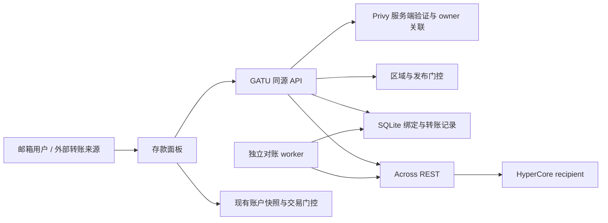

# Across 持久充值地址接入设计

状态：拟议，尚未实现、联调或发布。核对日期：2026-09-13。代码基线：`9750ccff`。本次仅交付方案；当前生产行为仍由 [CCTP 充值](cctp-deposits.md)、[首次交易](trading-onboarding.md) 和 [资金入口](account-overview.md) 约束。

## 1. 目标、范围与决策

为 GATU 邮箱用户提供“从交易所或其他钱包转入”的持久地址。用户完成外部转账后，由 Across 处理跨链，无需返回 GATU 再签署一次存款。缩短展示地址前对 Smart Wallet、Bundler、Paymaster 的依赖链，但不放松精确 owner、区域、账户模式和首次交易门控。

首期使用服务端 REST 适配层，不引入 Across App SDK、Swap API、Gasless API 或新的钱包 Provider。保留外部钱包 CCTP、邮箱钱包已有余额的显式 CCTP 存款及所有在途恢复。首期只对 mainnet 邮箱嵌入式 owner 开放；外部钱包、Agent-only、观察地址、子账户、vault、多签 owner 和测试网不进入新地址路径。

产品支持集合为“已验收的 USDC 网络白名单 ∩ 该地址当前 `supportedInputs`”。先验证 Arbitrum 原生 USDC，再逐条验证 Ethereum、Base、Polygon；不因 API 多返回某条链就自动展示。USDT、Tron、非 USDC 资产、法币、提现和自动 Spot→Perp 划转不在首期范围。

长期取舍见 [ADR 0004](adr/0004-across-deposit-addresses.md)。本方案取代的是拟实施范围内的邮箱充值入口，不宣布 CCTP 退役，也不以第三方源码覆盖本项目规范。

## 2. 已核对的外部契约与证据边界

| 事实 | 来源与实施含义 |
| --- | --- |
| `POST /deposit-addresses` 以目标币种、recipient、refund 配置返回地址；相同参数可重复取得相同地址 | [地址指南](https://docs.across.to/introduction/persistent-deposit-addresses)。金额不参与创建；地址长期有效不等于路线、费用和限额长期有效 |
| 地址功能为 Early Access，需要 `deposit-address` 权限；退款参数正文称可选，schema 要求数组但允许空数组，GATU 要求非空 | [创建接口](https://docs.across.to/api-reference/deposit-addresses/post)。空数组没有自动退款路径；响应 `id` 是请求诊断标识，不能当本地稳定地址 ID |
| 地址查询使用 `/deposits?depositAddress=...`，明细使用 `/deposit?depositTxnRef=...` | [列表](https://docs.across.to/api-reference/deposits/get)、[明细](https://docs.across.to/api-reference/deposit/get)。地址过滤模式忽略除分页外其他过滤项；本地仍需核验记录归属 |
| 生产服务需要 API Key / Integrator ID | [鉴权页](https://docs.across.to/introduction/api-keys)。地址示例使用 `https://across.to/api`，通用页使用 `https://app.across.to/api`，创建 schema 又未明确 Integrator ID 字段；须凭权限联调确认，不猜请求字段 |
| HyperCore 在 Across 路由命名空间使用 `1337` | [HyperCore 指南](https://docs.across.to/introduction/hypercore)。不是让钱包切到 EVM chain 1337；HyperEVM EVM chain ID 仍为 999 |
| 当前地址示例目标为 USDC-SPOT，标识 `0x2000000000000000000000000000000000000000`，8 位精度；源链 USDC 示例为 6 位 | [创建接口](https://docs.across.to/api-reference/deposit-addresses/post)。两者精度和余额语义不得混用 |
| 新版统一 API 文档包含 staging 主机和不同状态模型 | [新版 API](https://exclusive.docs.across.to/introduction/v5-api)。本方案以 public 地址 API 为基线；不混用 `/v1/quotes`、`executions`、`transfers` 或其 `isTerminal` 等字段 |
| Privy access token 需在后端验证，再获取用户的可信钱包关联 | [access tokens](https://docs.privy.io/authentication/user-authentication/access-tokens)、[身份令牌](https://docs.privy.io/user-management/users/identity-tokens)。客户端 `walletAddress`、邮箱字符串和 `authenticated=true` 都不能充当服务端证明 |

核对确认的是公开开发契约，不是本项目已取得生产额度、具体路线已获权限或资金已到账。普通 Swap token 目录出现 USDC-PERPS，不足以证明同一目标可用于持久地址。首期选择 SPOT；若联调需要 PERPS，必须单独修订目标设计与验收。禁止复制 Hyperliquid 官方前端使用的凭证或依赖其未公开的 `/hyperliquid-transfers` 服务。

## 3. 用户流程与现有门控

1. 用户打开存款，按既有 legal、geo、owner 和 onboarding 顺序决定能否继续。自动弹窗仍仅用于完整、新鲜、明确为空的账户快照；手动存款不要求账户为空。
2. 邮箱用户看到“从交易所／其他钱包转入”和“存入钱包现有 USDC”。第二项保留当前显式 CCTP 行为；不把旧余额自动扫入新地址。
3. 选择转入后，解析并激活当前用户的准确 embedded owner，后端验证其归属。仅需普通 owner 能力，不构造 Smart Wallet，不请求 EIP-3009，不进行 Agent 或 builder-fee 审批。
4. 后端持久绑定成功，目的/退款/地址、输入路线/精度/限额验证通过且所有展示门控通过，才返回可展示地址。前端显示网络、原生 USDC、QR、复制地址、限额、预估费用/时间、HyperCore 收款语义和 Across 服务说明。ETA 可空，缺失时隐藏预计时间，不阻止展示；首期额外要求可解释的费用信息，缺失时禁止新曝光/复制，这是 GATU 产品门槛，不是 Across 强制要求。
5. 用户在交易所或外部钱包转账；关闭弹窗不影响 Across 处理。GATU 跟踪到账与退款；“完成”只关闭页面，不代表已到账。
6. Across 报告交付后刷新 HyperCore 数据。展示“已到账”和“可用于交易”使用不同证据；需划转时沿用显式内部转账操作，不自动签名或切换账户模式。

`DepositAvailability.path` 当前只有 `external | sponsored`，应改成明确的 `external-cctp | embedded-cctp | across-address` 能力集合，由同一 chooser 和所有入口消费。Across 使用独立服务端 capability，不能复用或放宽 sponsored CCTP flag；CCTP 的 `usdcRouting === cctp` 检查继续原样生效，Across 不因这个返回值就被认定可用。

区域未知或受限时不得新建/曝光可操作充值地址。后端复用服务器真实 IP 和已有 fail-closed verdict；开发回环豁免仅存在于开发模式。前端的地区结果不能替代后端校验。公开网络的资金可能继续流入历史地址，服务端门控不被表述为能阻止这些转账。

现有 [移动数据展示](mobile-data-presentation.md)、[翻译](i18n-presentation.md) 和 [签名身份](adr/0002-exact-owner-trading-signers.md) 保持有效：被动失败用 skeleton、空列表、`aria-busy`；未知费用不能显示“免费/0 手续费”，用中性占位且不提供有效新地址。实际发现的充值/退款问题属于资金操作反馈，可以提供状态、交易引用和处理入口。

## 4. 服务边界与文件落点

| 模块 | 现有位置 / 拟新增位置与责任 |
| --- | --- |
| 同源 API | 采用现有 `apps/terminal/src/routes/api.leaderboard.ts` 的 server handler 模式；新增 `routes/api.deposits.across.*.ts`，不手改 `routeTree.gen.ts` |
| 服务端身份 | 新增 `lib/auth/privy-server.ts`，使用服务器专用 `@privy-io/node` 依赖；当前项目没有该验证层 |
| 外部 API | 新增 `lib/across/server/client.ts`、`schemas.ts`、`service.ts`，白名单主机、超时、schema、归属验证、错误归一化；不返回原始 upstream JSON |
| 领域模型 | 新增 `domain/trade/across-deposit.ts`，地址绑定、状态和数值转换；Big.js/整数表示，组件不做金融计算 |
| 持久化与后台任务 | 新增 `lib/across/server/repository.ts`、数据库 migrations 和独立 worker 入口；后台按租约对账 |
| 能力/数据 | 扩展 `domain/trade/deposit-availability.ts`、`hooks/trade/use-deposit-availability.ts`；新增 `hooks/trade/use-across-deposit-address.ts` 和 `use-across-deposit-transfers.ts` |
| 存款 UI | `components/trade/tradebox/deposit-modal.tsx` 只做方式分发，新增共享 Across 面板；保留 `lib/hyperliquid/use-deposit.ts` 的 CCTP 执行边界 |
| 自动引导 | `components/trade/components/trading-onboarding-gate.tsx`、`domain/trade/onboarding.ts`，保持现有一次性 intent 和精确 owner 门控 |
| 恢复 | 保留 `components/trade/tradebox/embedded-deposit-auto-bridge.tsx` 与 `hooks/trade/use-cctp-deposit-tracking.ts`；Across 是独立提供方的记录，不写进 CCTP nonce/hash store |
| 部署 | 更新 `deploy/gatu.service` 的配置说明、`deploy/README.md`、环境示例和现有部署校验，新增对账 worker service；不在本轮执行 |

服务器模块不得从浏览器入口、barrel 或共享组件反向导入。最终浏览器构建必须证明没有 Across Key、Privy Secret、数据库驱动或整个 App SDK。

## 5. 拟新增的 GATU API 与身份契约

以下是本项目拟定接口，不是 Across 的现有 API。全部同源、`Cache-Control: private, no-store`，响应不得进入 CDN、Service Worker 或共享 SSR 缓存。

| 接口 | 契约 |
| --- | --- |
| `GET /api/deposits/across/capability` | 验证当前用户后返回环境及该用户的有效资格（含 pilot）、支持的产品网络集合和维护状态；不包含秘密或用户地址，避免非灰度用户进入必然失败的表单 |
| `POST /api/deposits/across/address` | 输入限于 network、expectedOwner 和产品配置版本；获取/复用绑定。前端不得传任意 recipient、refund、上游 URL 或目标 token |
| `GET /api/deposits/across/addresses` | 返回当前已验证 owner 可见的历史绑定及脱敏诊断信息；停用时只返回历史展示所需信息，不重开新充值按钮 |
| `GET /api/deposits/across/transfers?addressId=...&cursor=...` | 本地 opaque ID 分页；服务器检查绑定归属，返回规范化转账状态，客户端不能指定任意链上地址代理查记录 |

新建/操作性曝光处理次序：请求大小/方法/origin 限制 → Bearer access token 验签、issuer/audience/expiry → 用验证出的 DID 查询 Privy 用户 → 从可信关联中确定邮箱 embedded EVM owner → 比较 `expectedOwner` → 产品/geo/合法使用条件 → 持久仓储与 Across。历史 `/addresses`、`/transfers` 只要求认证、owner 归属、限流与隐私控制，不因新的 geo/legal/发布门控而封死恢复；worker 使用服务凭证，无需用户保持登录。token 不发给 Across；只传完成充值所需地址与路线。

首期只接受该用户确定的 embedded owner。解析应与 `lib/wallet/privy-wagmi.ts` 的 primary/唯一钱包/明确 walletIndex 规则对齐；多条关联无法唯一解析、主测试环境错配、已解绑或请求 owner 不一致均拒绝，不回退数组第一钱包。排除 `smart_wallet` 地址。新建钱包尚未同步到 Privy 服务端目录时只重试验证，不信任浏览器直接提供的创建结果。token 中的 DID 不等于某钱包控制权；获取钱包关联是单独步骤。用户登录恢复、刷新和地址创建不发钱包签名。

现有客户端 legal gate 保留；新地址曝光在服务器按同 owner/environment 只读调用 Hyperliquid `legalCheck`，复用 `packages/hl-react/src/legal.ts` 的纯解析语义，不导入 React hook，不接受客户端布尔值。该接口是项目锁定 SDK 的契约，未作为通用公开 API 文档化；P1 验证后端出口和真实 schema，且不能用服务器所在地代替用户 geo。未接受与请求失败是不同状态，均不能曝光新地址；这里不调用 `acceptTerms2`。历史查询和在途对账不受新的 legal/geo 写操作门控阻断，身份归属验证仍必需。

服务端固定 `destination.recipient = exactEmbeddedOwner`，首期退款固定为同一 owner 的 EVM 地址，不能使用 Agent、Smart Wallet、Across 地址或不受用户控制的服务端地址；从交易所转入也不能把交易所热钱包发送方当退款人。每条首发源链必须有该 owner 的退款资产查看及显式转出路径，说明所需源链 Gas；当前仅有 Arbitrum USDC 存款能力不能当作 Base/Ethereum 退款恢复能力。新增网络以这项验收为前置条件。

建议 `400` 参数/schema、`401` 身份失效、`403` owner/地区/产品不符、`409` 参数或地址映射冲突、`429` 限流、`502/503` 上游/存储/维护不可用。统一使用本地错误码，不透传含账户数据的 provider 错误。

## 6. 持久绑定、金额与缓存

当前项目的服务器缓存/限流主要为进程内 Map，没有现成持久账本。首期按当前单主机 systemd 部署选 SQLite 仓储，放在 `/opt/gatu/shared/across/deposits.sqlite3`，不放在 repo、`.output` 或按版本替换的 release 目录。新增服务器专用驱动拟用 `better-sqlite3`，实施时锁定与 Node 22 及部署 Linux 架构兼容的版本，验证其 SQLite 版本与已公布修复；本方案没有新增依赖。

数据库采用事务、唯一约束、WAL、`synchronous=FULL`、有界 busy timeout；外部 HTTP 不持有数据库写锁。限流和 worker 租约在同一仓储中原子处理，不能依赖单进程 Map。目录归 `gatu:gatu`，目录 0700、DB 0600。禁止网络文件系统及多主机共享 SQLite；多机扩容前迁移 PostgreSQL 适配层。备份使用在线备份 API，并验证恢复，不能只复制正在写入的 `.sqlite3` 主文件。[SQLite WAL](https://sqlite.org/wal.html)、[备份](https://sqlite.org/backup.html)、[驱动](https://github.com/WiseLibs/better-sqlite3)

建议存储：

- `address_bindings`：本地 UUID、环境、Privy DID/钱包 ID、owner、目的 token/chain、refund、规范化请求、参数哈希、创建状态与时间。唯一键绑定 app/environment/user/owner/完整目的与退款参数；金额、语言和源链选择不参与该地址请求身份。
- `address_instructions`：绑定 ID、namespace/address、规范化支持路线、`checkedAt`、产品验收版本。保存原始诊断 request id，但不将它作为稳定身份。
- `transfers` / `transfer_events`：绑定 ID、源链/币种/原始金额、provider 转账身份、inbound/sweep/destination/refund 各自引用、原始状态、归一化状态、观察时间和变更历史。
- `sync_jobs` / 限流桶：扫描检查点、租约 owner/到期时间、重试时间；支持重启恢复和并发上限。

先记录待创建请求，再调用上游；只在响应目的地、退款、地址格式和路线校验通过且 DB 提交成功后曝光 QR。超时或进程崩溃后用相同规范化参数重试；返回地址与已保存绑定不一致则停止曝光并报警。API Key 轮换不自动创建新 recipe，不删除旧绑定。退款/目的参数变更创建新版本，旧版本仅退役展示，继续保存与对账。

同时对 `(provider, environment, namespace, address)` 建立唯一归属约束：同一物理地址不可意外分配给不同目的/退款配置。合法重试或兼容 recipe 版本指向已有地址时复用同一 instruction 记录，不启动重复 worker；出现冲突时停止曝光，保留原映射待调查。

必须遍历并按 `namespace=evm`、目标及已验收输入 chain/token 明确匹配 `depositInstructions[]`，不能默认第一条就是目标 EVM 地址；没有唯一匹配或多条相互冲突的结果停止曝光。切换源链时重新匹配，即使地址看起来相同。金额以十进制字符串或 base-unit 整数字符串保存。使用每个 inputToken 的 decimals 解析 limits；HyperCore token 的精度独立。精度缺失且无已验证 token registry 补全时不展示该路线。限制、费用或时间缺失不能按 0 处理，ETA 单独按可空字段处理。金额上限/下限取产品限制与实时路线限制的交集；API 的“amount-agnostic”不意味着无最低存款。

地址可长期缓存，产品路线有效性首期建议缓存 60 秒，超期复核后才允许新曝光/复制。窗口过期、切换 owner/network、退出或 geo 变化立即隐藏旧 QR 并取消旧上下文请求；后台返回结果必须匹配当前 context epoch。客户端 Query key 含环境、用户、owner 和 recipe，不加入现有全局持久 Query 白名单；认证凭证、完整地址及历史不要持久到 localStorage。永久地址映射是服务器事实。

## 7. 到账、退款与持续对账

地址状态与某一笔转账状态分开：地址请求失败不表示充值失败，查询结果为空不表示用户没转账。记录必须识别多次充值；不能照教程只处理“最新一笔”。

| 观察到的情况 | GATU 处理 |
| --- | --- |
| 尚未查到转入 | 没有已确认转账；保持地址说明或空列表，不写失败或成功 |
| `deposit-pending` | 已发现转入，等待归集；保留 inbound 引用 |
| bridge pending / unfilled / slow-fill 等已知非终态 | 处理中，按 API 实际 schema 归一化；保留 provider 原始状态 |
| `filled` / `slowFilled` 等交付候选 | 核对目标 owner/token/amount/链与目的交易证据；随后刷新账户，不把单一状态直接映射成可交易余额 |
| `expired` | 未完成交付，等待退款或恢复；不是本项目的完成态，继续对账 |
| `auto-refund-pending` | 退款处理中；源链退款不等于 HyperCore 到账 |
| `refunded` | 先记录 provider 报告已退款；核实退款引用、币种、金额、网络和 owner 后才标记退款确认完成 |
| `refund-failed` / `manual-refund-required` | 保留可恢复问题和诊断 ID，进入人工处理队列，不丢失后续更新 |
| 未识别状态、超时、索引延迟 | 未确认；继续安全重试或升级排查，不默认终态 |

列表模式忽略其他过滤器，因此详情返回时再次核对绑定、namespace、源链、目的 owner/token；不相信请求中的 filter 已完成隔离。P0 固定各路线最终 HyperCore 目标的证据字段（可能为 `actionsTargetRecipient/Token/ChainId/Amount/TxnRef`）；桥级 recipient/目标链可能是 HyperEVM 中间执行层，不能机械等同最终 owner。字段缺失或含义未确认则保留未确认交付。`depositTxnRef` 是用户转入地址的交易引用，`sweepTxnRef` 是归集引用，两者不能混作交易主键。Phase 0 必须取得 provider 稳定转账 ID 或可区分同交易多次事件的组合身份；仅 `(hash)` 不足以去重。未知身份的记录保留为未确认，不能覆盖另一笔或触发到账通知。

独立 systemd worker 使用同一服务端适配器和 DB，重启/退役 release 后仍可运行。建议初始参数：活跃转账 10 秒、最近曝光地址 30 秒、历史地址 15 分钟轮询；全局最多 2 个上游并发、单请求 10 秒超时，429 遵守 Retry-After，其他故障按 5/15/60 秒加抖动退避。以上是待额度和负载验证的 GATU 初值，不是 provider SLA。每个 UI 请求只读仓储并触发去重的加急扫描，不各自无限轮询上游。

列表使用重叠分页与持久检查点，避免新转入挤动 `skip` 导致遗漏；定期全量补扫，历史地址持续轮转。分页上限、跨重启补扫、同交易多转入、重复/乱序更新需夹具验证。首次灰度只允许工作队列可在额度内完整覆盖的地址数；超出时暂停新曝光，不能静默放弃旧地址。未来 webhook 可减少发现延迟，但需独立验证权限、验签和事件覆盖，不能取消轮询补偿。

HyperCore 交付成功与账户可交易分开保存：同 owner 的新鲜账户快照恢复可用后，才按当前 `disabled/manual`、`unifiedAccount`、`portfolioMargin` 语义启用交易。余额变化可能来自其他交易，不能用 delta 单独证明某笔充值到账。如果 SPOT 需要转往 Perp，必须提供既有显式划转；不自动切账户模式、接受条款、审批 Agent 或 builder fee。未经分别验收的模式暂不曝光新地址。

## 8. 安全、运行配置与回滚

拟新增运行时配置：`ACROSS_API_KEY`、`ACROSS_INTEGRATOR_ID`、`ACROSS_API_BASE_URL`、`PRIVY_APP_ID`、`PRIVY_APP_SECRET`、`ACROSS_DEPOSIT_DB_PATH`、`ACROSS_DEPOSIT_ADDRESS_MODE=off|pilot|on`、`ACROSS_DEPOSIT_PILOT_USER_IDS`、`ACROSS_DEPOSIT_TRACKING_ENABLED`。字段是规划，尚未加入 env schema。秘密不得使用 `VITE_` 前缀；生产 URL 限白名单并拒绝自动跨主机转发 Authorization。Privy 服务端 App ID 必须与浏览器构建配置一致。公开 UI 由服务端 capability 决定；浏览器全程同源调用，无需把 Across 加入 `connect-src` 或部署第二套 CSP。

默认 `off`：停止新建与操作性曝光；已有绑定的查询与退款对账由独立 tracking 配置维持。首次曝光前必须完成至少一次备份与恢复演练。新建限流建议每用户每分钟 5 次、每 IP 每分钟 20 次，历史查询每用户每分钟 60 次，另加进程外共享的全局预算；参数随已授权配额调优。查询每次验证归属；禁止任意地址代理和由跨域站点读取资金记录。

存在已曝光地址时，常规部署或回滚预检拒绝静默关闭 tracking。worker 健康租约失效、tracking 关闭或积压超过验收容量时，capability 自动关闭新建/新曝光并报警；历史读取仍可用。记录保留最后观测时间，按被动数据规则呈现，不把缓存结果当实时成功。紧急停用 worker 必须记录影响与恢复方案，不能以删除 DB 或撤销 Key 代替处理在途资金。

自动日志只保留内部关联 ID、路线和错误类别，不记录 JWT、上游授权头、邮箱、完整私钥/签名或完整账户响应。地址和交易引用仅保存在受控仓储/客服按需记录；监控不以用户地址作为高基数标签。隐私说明需覆盖向 Across 发送收款/退款地址及第三方索引，不能宣称零外部数据共享。

回滚关闭新曝光，保留 CCTP、历史记录、worker、数据库和供应商权限。已复制地址可能继续收款；不得把关闭开关描述为地址失效，不自动把旧地址改指向新 owner。申请 Across 前先确认 key 撤销、集成停服、地址退役和退款规则；没有这些运营约定，不能向公众发永久地址。生产数据库 schema 采用兼容扩展，不随旧 release 回滚执行破坏性 downgrade。

## 9. 分阶段实施与交付

| 阶段 | 开发交付 | 完成条件 |
| --- | --- | --- |
| P0：供应商与资金落点验证 | 锁定 API host/version、Key/权限/Integrator ID 用法、USDC-SPOT 路线、稳定事件身份、费用精度、退款及永久地址退出机制；收集脱敏 schema 夹具 | 有可重复的真实权限响应；未取得权限也可继续 mock 开发，但不曝光生产地址 |
| P1：后端基础 | Privy 验证、legal/geo门控、SQLite migrations/仓储、幂等创建、查询、限流、worker、运行时配置和部署预检 | 身份隔离、重启恢复、并发/超时/备份恢复测试通过；前端仍关闭 |
| P2：共享 UI 与迁移 | 能力拆分、邮箱方式选择、QR/网络/费用、转账状态、旧余额入口；保留 CCTP/onboarding 原顺序 | 桌面/移动/切语言/切账户无旧地址闪现、无隐式签名；旧资金恢复回归通过 |
| P3：灰度真实资金验收 | 每条首发网络和账户模式的小额转入、跨刷新恢复、重复转入、供应商支持的退款演练及监控 | 每笔有源交易、实际目的/退款证据；费用、到账和可交易语义可解释；签名/转账由用户或授权操作员完成 |
| P4：发布与维护 | pilot 扩展到 on；发布说明、支持教程、备份轮换、额度报警与回滚演练 | 监控覆盖历史地址；值班/供应商升级路径明确；失败时可关闭新入口而继续处理旧资金 |

P1 与 P2 的 mock 面板可并行实现，但 P0 阻止生产启用，P1 完成前不得返回可充值地址。首期不删除旧 sponsored 依赖；只有旧余额、在途授权和恢复需求均有可验证替代后另行退役。

P0 需逐项取得答案：`proportionalPct` 的倍率、固定费包含哪些归集/源链/目的链费用、资料有效期；过小/超额/重复小额是否聚合，误链误币如何处理；退款网络/币种/手续费/重试与支持时限；Key 轮换/撤销和停服是否影响已发地址；provider 的 `filled` 是否包含最终 HyperCore 动作、重组如何修正；测试环境是否真正支持 PDA→HyperCore。不得把一般 Swap 支持、普通 testnet 免 Key、通用退款时限或旧 suggested-fees 倍率直接套用到地址 API。

实施同一变更同步更新：`docs/cctp-deposits.md`（明确保留范围）、`docs/trading-onboarding.md`（由 method capability 选择路线）、`docs/email-trading-signing.md`、`docs/account-overview.md`、`docs/mobile-data-presentation.md`、`docs/runtime-guardrails.md`、部署/环境示例、支持与隐私文案、`CHANGELOG.md`。当前 canonical CCTP/onboarding 文档中的“新存款仅 CCTP”要求须在实现时显式修订为按方式约束；同步核对 AGENTS 的相关不变量，不能绕过或默默放宽。本轮不把这些文件改成已支持 Across。

## 10. 验证计划与度量

实施所需单元/集成测试：

- 伪造/过期/错 audience token、跨用户地址读取、邮箱但无准确 embedded owner、多关联、解绑、geo失败、legal不明、Agent-only/子账户误入、主测试混淆。
- 相同参数并发重试只对应一个绑定；创建成功但响应丢失/DB失败不曝光；API key轮换、不同refund版本、provider地址突变、超时/429/未知schema/可空费用。
- 多转入、相同hash多个事件、分页插入/迟到数据、归集和源hash区分、退款异常、未知状态、API filled但目标不匹配、源成功目标未到、账户模式切换。
- 回滚关闭新入口后旧地址仍对账；旧 CCTP nonce/源hash恢复、邮箱余额显式存款不变；没有 refresh/login/轮询自动签名。
- SQLite并发租约/磁盘故障/重启、在线备份恢复、Linux Node native依赖、server-only秘密与数据库驱动不进入浏览器产物。

实施后命令：`pnpm exec biome check <改动的 TS/TSX>`、`pnpm typecheck`、`pnpm --filter @gatu/terminal test`、`pnpm build`，并按 AGENTS 运行钱包/onboarding、资金可用性、移动展示、i18n和新 Across 测试。运行已有部署校验及新增预检；浏览器用独立 Vite fixture cache，在 375px、1000px、1440px、明暗主题及中英热切换检查共享面板。mock API 不是真实资金验收，testnet/sandbox通过不等于mainnet通过。

记录相同设备/网络下的首次地址可用耗时、重复打开耗时、源交易确认→API发现→目标交付→账户可交易的分段 p50/p95、所需用户操作次数、实际总费用、退款时延与失败率。与现有 CCTP 同条件比较，不承诺“2 秒到账”或把本次文档核对当性能结果。首次创建性能依赖上游；建议重复打开目标 p95 < 1 秒、无秘密/owner串用为零容忍，最终阈值以 P0/P3 数据确定。

## 11. 当前结果与待提供资料

本轮完成公开文档与本地接口边界审查，未运行存款、签名、代码构建或生产部署。文档校验结果见 [任务记录](work-memory/sessions/2026-09-13-across-deposit-address-plan.md)。

实施前需：GATU 自己的 Across API Key/Integrator ID 及 `deposit-address` 权限（通过服务器秘密配置提供，不贴聊天）；该 Privy app 的服务端配置权限；确认现有单主机的持久目录、备份位置及 worker 运维归属；确定灰度用户和用户自行操作的小额验收窗口。永久地址、退款及 Key 退出约定向 Across 确认。拿不到供应商权限不阻碍完成后端和界面的 mock 开发，但必须保持生产关闭。
